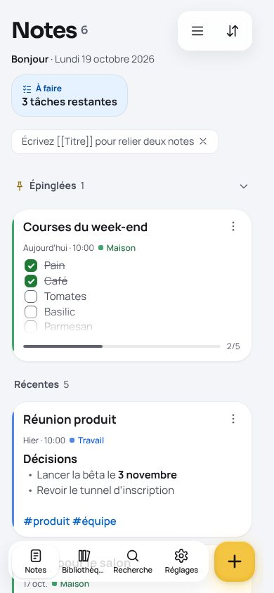
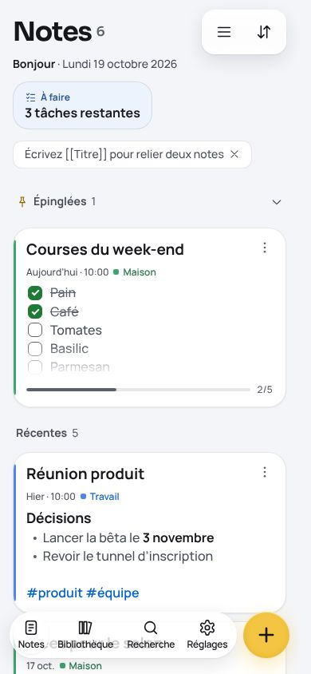
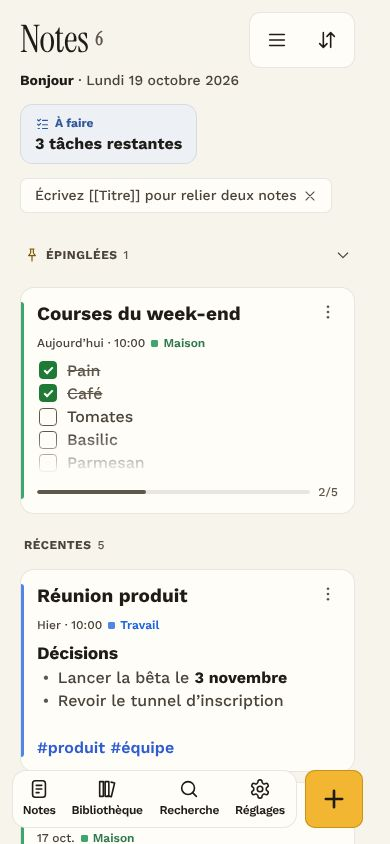
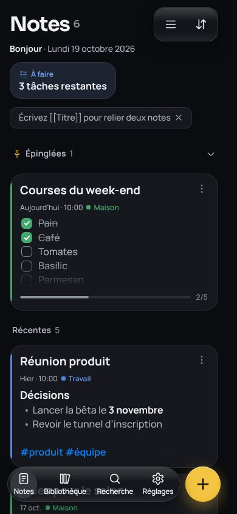
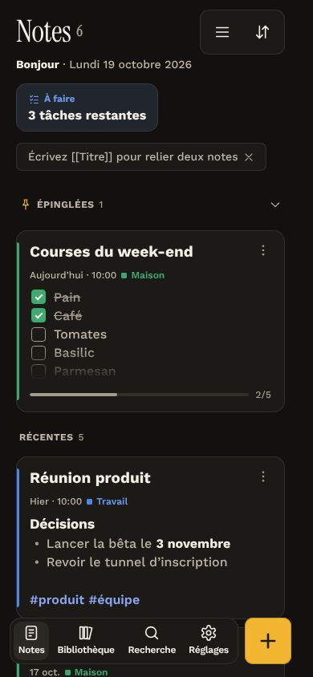
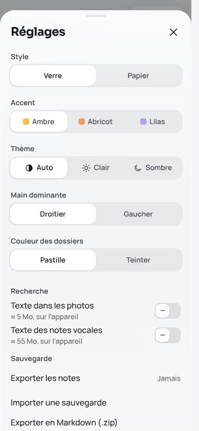
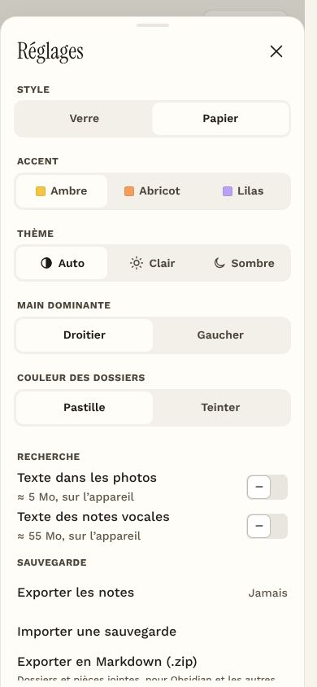

# Notes — design teardown

The notes-v3 port now has **two looks**, chosen in Réglages → Style: **B · Soft Glass Pro** (default) and **A · Paper and Ink**.
Both sit on one token foundation (`src/notes/styles/tokens.css`). A look only re-points tokens (`looks.css`). The components
(`app.css`) read tokens and never test which look is on. The work is visual only: component logic is unchanged, and the
one new preference (Accent) uses the existing pref plumbing.

| | Before (notes-v3 port) | Glass (default) | Paper |
|---|---|---|---|
| Phone, light |  |  |  |
| Phone, dark | — |  |  |
| Réglages | — |  |  |

All 12 home screens (390 / 768 / 1280 × both looks × light / dark), the editor and the high-contrast screens are in [`shots/`](shots).

---

## 1. KEEP / CHANGE / REMOVE / ADD

### KEEP
- **Colour meanings**: amber = create and pinned, blue = selection and links, red = delete and recording, green = done,
  ink = focus, primary buttons and progress. Both looks and all three accents keep them.
- **Thumb-first layout**: the dock and + at the bottom, mirrored for left-handers; menus open above the dock; sheets come up from the bottom edge on a phone.
- **Sizes**: 44px minimum touch targets (small controls — chips, pills, ⋮ — are drawn at 34px and touched at 44px), 48px dock buttons, a 58px +,
  16px inputs, and content that clears the dock and the keyboard (`--dock-space`).
- **Glass only on what floats**: dock, menus, sheets and toasts. Content is solid, and glass is never stacked on glass.
- **Accessibility**: muted text ≥7:1. High contrast, reduced motion, reduced transparency and forced colours are all honoured, and the device's preference wins over the look.
- **The ÷3 shape rule**: a control's radius is its height ÷ `--radius-ratio`, and containers stay concentric (inner radius + padding).
- **Masonry cards** on Glass, the recap bento, the pinned shelf and the compact list.

### CHANGE
- **Type**: 9 sizes (11, 12, 13.5, 15, 16, 17, 21, 26, clamp 30–38) → 6 steps on a 1.2 ratio: **12 / 14 / 16 / 19 / 23 / 33**.
  Body 15 → 16, secondary 13.5 → 14, dock labels 11 → 12. Paper keeps two serif display sizes of its own (38 / 28).
- **Weights**: 400, 500, 550, 600, 650, 700, 750, 800 and 900 → **500 body, 600 labels, 700 titles**. Paper's serif titles are 400, the only weight the face has.
- **Spacing**: 4 / 8 / 12 / 16 / 20 / 24 / 32 → **4 / 8 / 12 / 20 / 32 / 48** (16 → 12, 24 → 20).
- **Elevation**: the 4-layer glass shadow → `--shadow-1/2/3` (0 1 2 / 0 8 24 / 0 24 60). Cards rest on 1, floating controls on 1 + 2, sheets on 3.
- **Opacity**: hex alpha suffixes → `--alpha-faint/soft/medium/strong` (6 / 10 / 20 / 40 %). Lines and fills are now the
  ink at a step, so they follow every look and scheme on their own.
- **Layers**: 26 z-index numbers → named layers: base, raised, dock, editor, sheet, popover, toast, modal. Menus now sit above any sheet.
- **Press**: `scale(.94)` and `.96` → one `--press: .97`, set to 1 under reduced motion.
- **Veil**: the blur behind sheets → a dim (40 % on Glass, 20 % ink on Paper).
- **Dock tabs**: equal widths cut "Bibliothèque" (in the baseline too). Tabs now share the island by label length, and the thumb follows (CSS `:has()`).
- **Kind tones**: the 9 iOS system tones → the 8 folder colours (red → danger). One palette.

### REMOVE
- `--tone-red … --tone-gray` (9 tones that duplicated the folder colours), `--color-card-solid` (a copy of `--color-card`),
  `--text-2xs`, `--weight-heading`, `--ease-out`, `--radius-row`, `--radius-control`, `--radius-card`.
- `.layer-chips` (its markup left in notes-v3 26.10.18.4) and the Figtree font package.
- Lovable's duplicate press rule (`scale` on top of `transform: scale`, so controls shrank twice) and its type overrides that bypassed the scale.

### ADD
- `looks.css`: Glass and Paper palettes and Accent (Ambre, Abricot, Lilas), plus device overrides that win over any look.
- Réglages → **Style** (Verre / Papier) and **Accent**, beside Thème.
- A pre-paint script in `src/routes/__root.tsx`: look, accent and light/dark are on `<html>` before the first paint. The app
  mirrors them to localStorage once its saved prefs load, and `styles.css` shows the right ground until the app's CSS arrives.
- `docs/shots/verify.mjs`: the screenshot, contrast, motion and contrast-mode checks behind this document.

---

## 2. Directions

### A · Paper and Ink
*Calm, editorial, printed. For reading and writing at length.*

| Aspect | Spec |
|---|---|
| Palette | Ground `#f7f4ec` / `#121110` · card `#fffdf7` / `#1c1a17` · ink `#1f1b16` / `#f3efe6` · muted `#4a4339` / `#bdb5a7` · faint `#5f574b` / `#a39b8d` |
| Meaning | Accent `#f2b632` (ink `#7d5800` / `#f2b632`) · select `#2f5bd3` / `#8aa6f2` · danger `#c8322b` / `#ff7a6e` · success as shared |
| Typography | Instrument Serif 400 titles (page 38, sheet 28, tracking −.01em / 0) · Work Sans 500 body 16, leading 1.55 · labels 12 uppercase, +4 % tracking |
| Spacing | Shared scale · 20px gutters |
| Radius | Ratio 4.8 → 10 (rows, controls) · 14 (cards) · 20 (sheets) · menus stay concentric (18) |
| Shadows | None, except sheets: `0 12px 32px rgb(0 0 0 / 10%)` |
| Borders | 1px hairlines at 10 % ink, on cards, dock and menus |
| Glass | None: the dock, menus and toasts are solid paper |
| Z-index / opacity | Shared |
| Layout | Masonry like Glass. List view is designed for Paper, but switching the look never changes your chosen view |
| Components | Squared 10px dock, solid + with a 1px amber stroke, no glow, ambient field off |
| Assets | `@fontsource/instrument-serif`, `@fontsource-variable/work-sans` (self-hosted) |

### B · Soft Glass Pro (default)
*Light, lifted, iOS-native. The lowest-risk evolution of notes-v3.*

| Aspect | Spec |
|---|---|
| Palette | Ground `#f4f5f8` / `#0b0c0f` · card `#ffffff` / `#17181d` · ink `#16171b` / `#f2f3f7` · muted `#484c59` / `#b0b4bf` · faint `#5d616d` / `#8e929b` |
| Meaning | Accent `#f4c542`, stroke `#d9a514`, ink `#8c6600` / `#e0ac1c` · select `#0062cc` (light, for 4.5:1 on white) / `#0a84ff` · danger `#d70015` / `#ff6961` |
| Glass | `rgb(255 255 255 / 62%)` (dark `rgb(38 39 46 / 62%)`), blur 28px, saturate 180 % |
| Typography | Sora 700 titles (page 33, sheet 23, tracking −.035em / −.02em) · Manrope 500 body 16 |
| Spacing | Shared scale · 16px gutters |
| Radius | Ratio 3 → 16 (rows, controls) · 22 (cards) · 28 (sheets) · a pill dock (999) with concentric pill tabs and a round + |
| Shadows | `0 1px 2px` 8 % · `0 8px 24px` 11 % · `0 24px 60px` 14 % (dark: 30 / 35 / 45 % black) |
| Borders | .5px hairlines at 10 % ink |
| Layout | Masonry stays · a floating pill dock lifted 4px · sheets dim the page to 40 % |
| Components | Glass dock, header tools, menus, toasts; near-solid glass behind long reads (Réglages) |
| Assets | `@fontsource-variable/sora`, `@fontsource-variable/manrope` (self-hosted) |

### C · Bold Utility (future option, not built)
*Dense, high-contrast and keyboard-first. For power users with many notes.*

| Aspect | Proposal |
|---|---|
| Palette | Ground `#ffffff` / `#000000` · card = ground with a 1px 20 % ink border · ink `#000` / `#fff` · muted at 9:1 · accent `#ffcc00` blocks with black text |
| Typography | Inter Tight or Geist 600 titles 23 · body 14 (inputs still 16) · tabular figures everywhere |
| Spacing | Compact: the 4 / 8 / 12 steps only; 12px gutters; the compact list as default |
| Radius | Ratio 6 → 8 (controls) · 8 (cards) · 12 (sheets) |
| Shadows / glass | None; elevation by 2px borders |
| Z-index / opacity | Shared |
| Layout | Two-pane from 48em; the dock becomes a top command bar on wide screens; ⌘K first |
| Components | Visible shortcuts on every control, the selection bar always on, dense recap row |
| Assets | One variable sans; no new icons |

It needs only a third `:root[data-look='utility']` block and a third Style option. The foundation already carries every token it would change.

---

## 3. Final tokens

Shared foundation (`tokens.css`); look values in `looks.css` (Glass · Paper).

| Group | Token | Value |
|---|---|---|
| Type | `--text-xs / sm / md / lg / xl / 2xl` | 12 / 14 / 16 / 19 / 23 / 33px |
| | `--text-input` | 16px, never themed |
| | `--text-title` / `--text-heading` | 33 / 23 · Paper 38 / 28 |
| | `--text-label`, `--label-case`, `--label-tracking` | 14, none, 0 · Paper 12, uppercase, .04em |
| | `--weight-body / label / title` | 500 / 600 / 700 |
| | `--weight-display` | 700 · Paper 400 |
| | `--font` / `--font-display` | Manrope / Sora · Work Sans / Instrument Serif |
| | `--tracking-title / heading` | −.035 / −.02em · Paper −.01em / 0 |
| | `--leading` | 1.45 · Paper 1.55 |
| Space | `--space-1 … 6` | 4 / 8 / 12 / 20 / 32 / 48px |
| | `--edge` / `--gutter` | 12 / 16 · Paper 12 / 20 |
| Radius | `--radius-ratio` | 3 · Paper 4.8 |
| | `--radius-xs / sm / md / lg` | 3 / height ÷ ratio (16) / 22 / 28 · Paper 3 / 10 / 14 / 20 |
| | `--radius-island / panel` | sm + 4 / sm + 8 (concentric) |
| | `--radius-dock / dock-btn` | 999 / 995 (pill) · Paper island / sm |
| Elevation | `--shadow-1 / 2 / 3` | 0 1 2 · 0 8 24 · 0 24 60 · Paper none, none, 0 12 32 10 % |
| | `--glass-shadow`, `--shadow-knob`, `--shadow-fab` | composed from the three |
| Opacity | `--alpha-faint / soft / medium / strong` | 6 / 10 / 20 / 40 % |
| Layers | `--z-base / raised / dock / editor / sheet / popover / toast / modal` | 0 / 1 / 20 / 30 / 40 / 44 / 60 / 70 |
| Motion | `--press` | .97 (1 under reduced motion) |
| | `--ease` | cubic-bezier(.32, .72, 0, 1) |
| | `--fast / base / slow` | 140 / 240 / 380ms (1ms under reduced motion) |
| Size | `--ctl-s / tap / dock-btn / fab` | 34 / 44 / 48 / 58px: the four control sizes (`.ctl.is-s` · `.ctl` · `.is-l` · `.is-xl`) |
| | `--hairline` | .5px · Paper 1px |
| | `--dock-lift` | 4px · Paper 0 |
| Colour | `--color-bg / card / raised / editor / text / text-muted / text-faint` | per look (section 2) |
| | `--color-line / line-strong / fill / fill-strong` | ink at soft / medium / faint / soft |
| | `--color-accent / accent-deep / accent-stroke / on-accent / accent-glow` | per look and accent |
| | `--color-select / select-tint / danger / danger-tint / success / highlight` | per look |
| | `--color-scrim / shade / on-strong`, `--veil-photo` | veils and text on strong fills or photos |
| | `--glass / glass-strong / glass-nav / glass-solid / glass-edge / glass-blur / glass-shine` | Glass only; Paper maps them to the card |
| | `--folder-1 … 8` (+ `-tint`, `-text`) | the one palette; kind tones map onto it |
| | `--accent-amber / apricot / lilac` | the Accent swatches |

### Hardcoded values in component CSS (declaration values in app.css + looks.css)

| Kind | Before | After |
|---|---|---|
| Colour literals (#hex, rgb(), white/black) | 27 | 0 |
| px border-radius not from a token or height ÷ ratio | 17 | 0 |
| z-index numbers | 26 | 0 |
| Shadows with a colour literal or raw elevation | 7 | 0 |
| px font sizes | 7 | 0 |
| Numeric font weights | 59 | 0 |
| Press scales on `:active` | 2 | 0 |
| TSX inline `style=` | 11 | 11, all runtime values (positions, progress, the thumb index); none can become a class |
| TSX colour literals | 0 | 0 |

Literals now live only in token definitions. Masks (`#000` in a gradient alpha mask) and the print stylesheet are not colours on screen and stay as they are.

---

## 4. Verification

`docs/shots/verify.mjs` drives Chromium with the clock fixed and six seeded notes in two coloured folders. It produces `results.json`.

### Contrast — 664 text runs, 0 failures (text ≥4.5:1, muted ≥7:1)

| Look | Scheme | Width | Screen | Runs | Min text | Min muted | Min faint | Fails |
|---|---|---|---|---|---|---|---|---|
| Glass | light | 390 | home | 35 | 5.29 | 7.85 | 5.67 | 0 |
| Glass | light | 390 | Réglages | 28 | 15.28 | 7.30 | 5.95 | 0 |
| Glass | light | 390 | editor | 7 | 4.53 | 8.26 | 5.97 | 0 |
| Glass | light | 768 | home | 49 | 5.29 | 7.68 | 5.67 | 0 |
| Glass | light | 1280 | home | 48 | 5.29 | 7.68 | 5.67 | 0 |
| Glass | dark | 390 | home | 35 | 4.86 | 8.55 | 5.68 | 0 |
| Glass | dark | 390 | Réglages | 28 | 15.27 | 8.16 | 6.15 | 0 |
| Glass | dark | 390 | editor | 7 | 5.74 | 9.24 | 6.14 | 0 |
| Glass | dark | 768 | home | 49 | 4.86 | 7.58 | 5.68 | 0 |
| Glass | dark | 1280 | home | 48 | 4.86 | 7.58 | 5.68 | 0 |
| Paper | light | 390 | home | 35 | 5.20 | 8.87 | 6.47 | 0 |
| Paper | light | 390 | Réglages | 28 | 14.95 | 8.52 | 6.99 | 0 |
| Paper | light | 390 | editor | 7 | 4.62 | 9.59 | 6.99 | 0 |
| Paper | light | 768 | home | 49 | 5.20 | 8.61 | 6.47 | 0 |
| Paper | light | 1280 | home | 46 | 5.20 | 8.61 | 6.47 | 0 |
| Paper | dark | 390 | home | 35 | 5.41 | 8.54 | 6.31 | 0 |
| Paper | dark | 390 | Réglages | 28 | 13.02 | 7.35 | 6.31 | 0 |
| Paper | dark | 390 | editor | 7 | 5.07 | 8.54 | 6.31 | 0 |
| Paper | dark | 768 | home | 49 | 5.41 | 7.58 | 6.31 | 0 |
| Paper | dark | 1280 | home | 46 | 5.41 | 7.58 | 6.31 | 0 |

- **Baseline** (the port before this work): 10 failures, all muted labels in dark segmented controls (6.22:1 on Glass, 6.73:1 on Paper). Fixed by deriving fills from the ink.
- **Found and fixed during this work**: muted text on a tinted widget, Glass dark, 6.61:1. Dark muted ink went `#a4a8b4` → `#b0b4bf` (7.58:1).

### Modes and must-keeps

| Check | Glass light | Glass dark | Paper light | Paper dark |
|---|---|---|---|---|
| Reduced motion: durations / press | 1ms / 1 | 1ms / 1 | 1ms / 1 | 1ms / 1 |
| High contrast: blur / card border / min muted | none / 1px / 11.73 | none / 1px / 11.84 | none / 1px / 13.26 | none / 1px / 11.44 |
| Dock buttons / + (px) | 48 / 58×58 | 48 / 58×58 | 48 / 58×58 | 48 / 58×58 |
| Visible buttons under 44px touch | 0 | 0 | 0 | 0 |
| Inputs (search / title / text) | 16 / 33 / 19 | 16 / 33 / 19 | 16 / 38 / 19 | 16 / 38 / 19 |
| Last card clears the dock by | 30px | 30px | 30px | 30px |
| "Bibliothèque" fits, 360–820px | yes | yes | yes | yes |
| First paint in the saved look, no flash | yes (pre-paint script, checked on Paper dark) | | | |

Build, typecheck (`tsc --noEmit`), lint (0 errors, 19 warnings: fast refresh and hook deps, as before) and vitest (1/1) pass.

---

## 5. Assumptions and decisions

- **`data-look`, not `data-theme`**: `data-theme` already carries light / dark, so the look goes on its own attribute (`data-look="glass|paper"`).
- **Fonts are self-hosted** (fontsource, imported with the app) rather than `<link>`ed: no third-party request and no preconnect needed.
  Only the faces of the current look download, because `@font-face` loads on use. Variable faces ship one file per subset.
- **Paper labels are 12px, not 13**: 13 is off the 6-step scale; uppercase 12 with +4 % tracking reads like 13.
- **Paper titles keep 38 / 28**, from the brief, as display sizes outside the shared scale; the serif runs small.
- **Glass blue as ink is `#0062cc` in light**: `#0a84ff` on white is 3.6:1. It stays `#0a84ff` in dark.
- **List view on Paper**: switching the look never overrides the view you chose. With Glass as the default, Paper is never what someone sees on a first visit, so there is no first-visit default to set.
- **Kind tones map to the nearest folder colour**: orange → 2, green → 3, teal → 6, blue → 1, purple → 4, pink → 5, gray → 8, red → danger. Indigo (study) → 7 (brun), the one folder colour left, which keeps study apart from the week view's violet.
- **Menus moved above sheets** (`--z-popover`): before, a menu opened from a sheet shared its layer.
- **The theme-color meta** follows Glass (`#f4f5f8` / `#0b0c0f`); a static tag cannot follow the look.
- **Prettier skips `src/notes`**, which keeps notes-v3's compact style so it can stay in sync with its source, and ESLint skips `public/vendor`. `eslint .` used to run for minutes on minified vendor code.
- **Known**: on a tablet, a lone recap widget clamps its title to one line ("3 tâches…"), as before, now with 16px text.

## 6. Files changed

| File | Change |
|---|---|
| `src/notes/styles/tokens.css` | the shared foundation: scales, layers, opacity, motion, sizes, Glass defaults |
| `src/notes/styles/looks.css` | Glass and Paper palettes, Accent, device overrides |
| `src/notes/styles/app.css` | every value read from a token; display titles, labels, the pill dock, the weighted dock tabs |
| `src/styles.css` | first-paint ground per look and scheme, at zero specificity |
| `src/routes/__root.tsx` | pre-paint script, Glass theme-color, `suppressHydrationWarning` on `<html>` |
| `src/notes/App.tsx` | mirrors look, accent and theme to `<html>` and localStorage once prefs load; Figtree import dropped |
| `src/notes/types.ts`, `ui/kit.tsx`, `ui/Sheets.tsx` | the `accent` pref, the `ACCENTS` options, Style and Accent in Réglages |
| `src/notes/db.ts`, `media.ts` | lint: why two boundaries are `any` (comments only) |
| `src/routes/index.tsx` | Prettier formatting only |
| `eslint.config.js`, `.prettierignore` | lint scope (see section 5) |
| `package.json`, `bun.lock` | Figtree removed; no dependency added |
| `AGENTS.md` | the memory rule: two looks, tokens only |
| `docs/` | this document, shots, `verify.mjs`, `results.json` |
